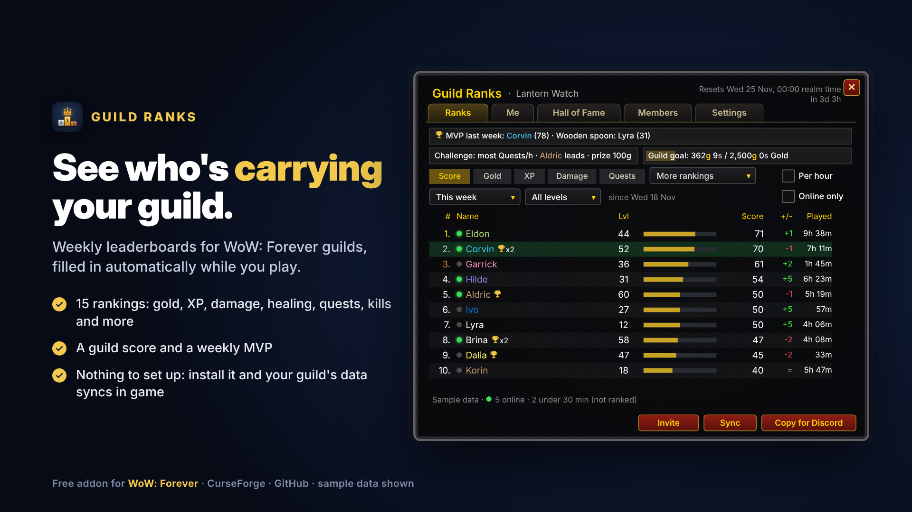
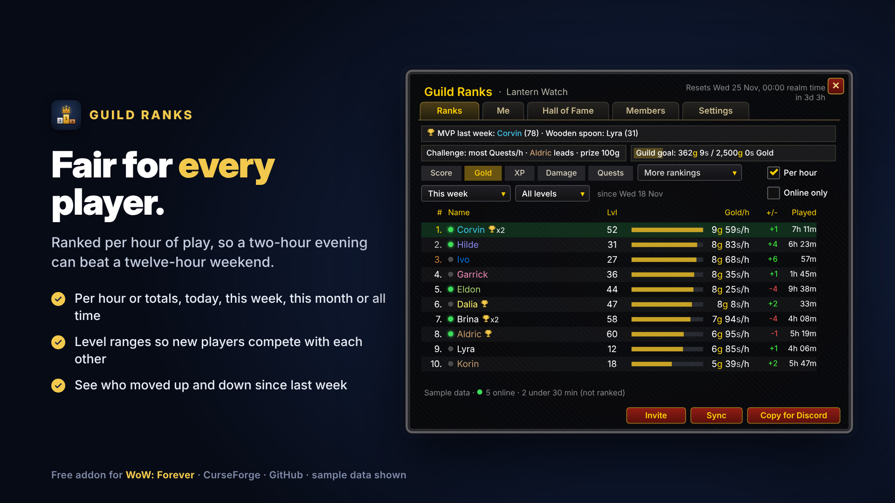
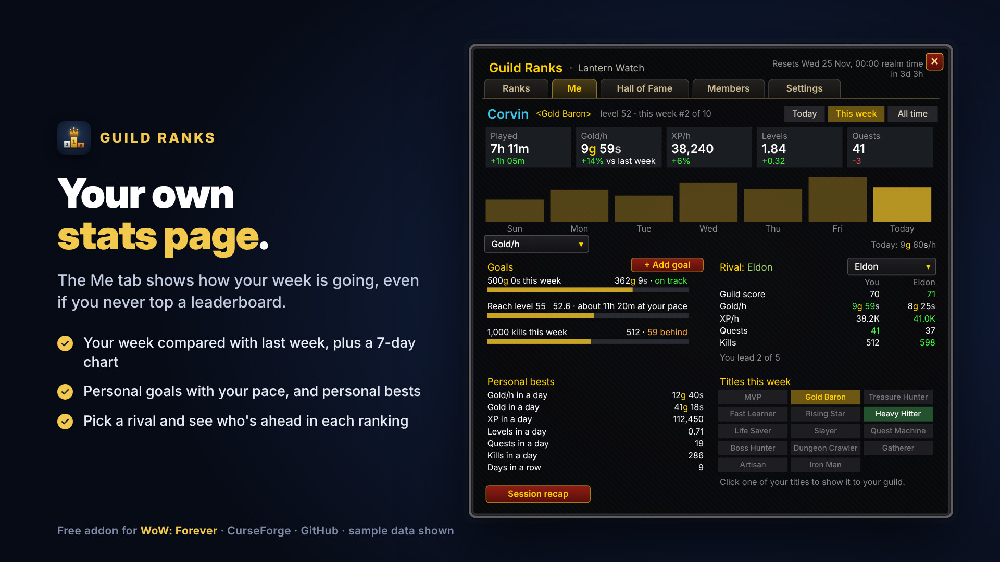
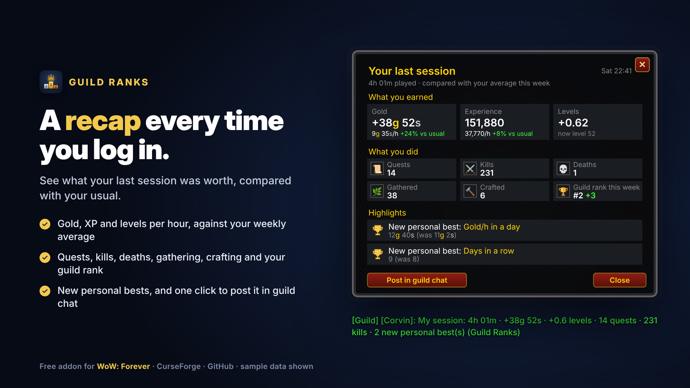
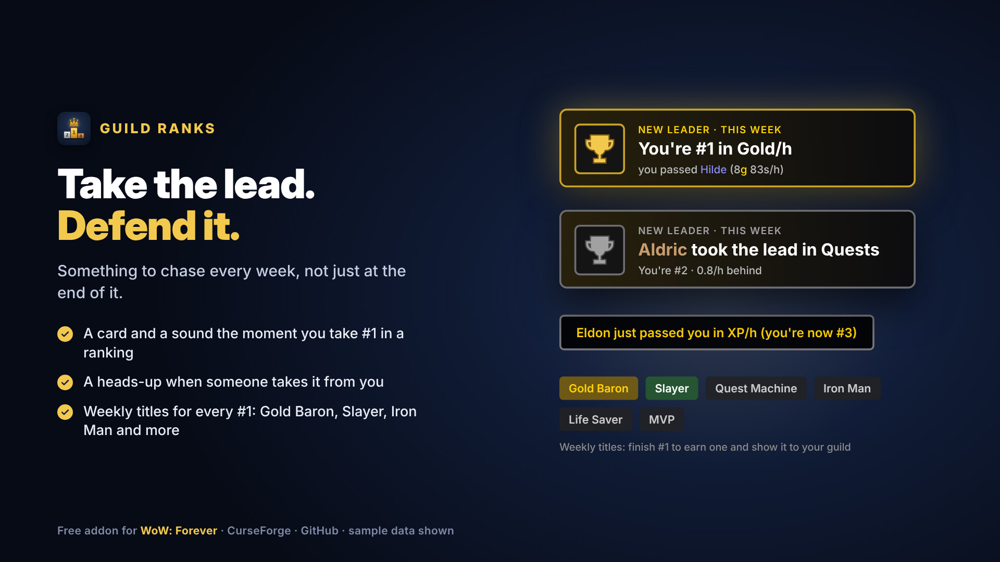
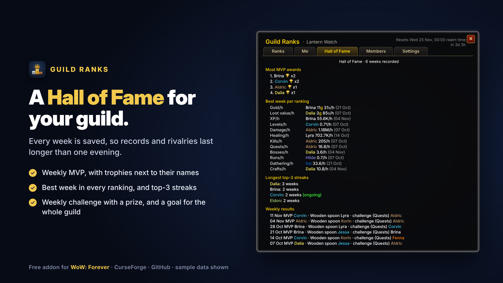
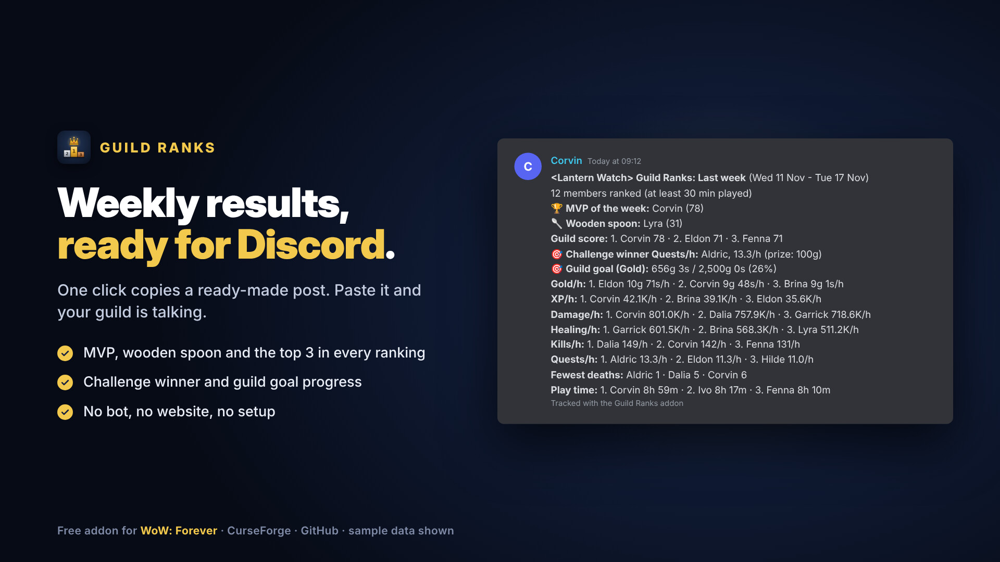

# Guild Ranks

**Weekly leaderboards for your guild in World of Warcraft: Forever.**
See who's carrying the guild, chase your own records, and crown an MVP every week.

## Why install it?

- 🏆 **A leaderboard for everything**: gold, XP, damage, healing, quests, kills, bosses,
  gathering, crafting, play time and more, plus one **Guild score** and a **weekly MVP**.
- ⚖️ **Fair for everyone**: ranked **per hour of play**, so a short evening can beat a long
  weekend. Level ranges let new players compete with each other.
- 📈 **Your own stats page**: your week against last week, goals, personal bests and a rival.
- 🔔 **Something to chase**: a card and a sound when you take #1, a heads-up when someone
  passes you, and weekly titles like *Gold Baron* or *Iron Man*.
- 🏁 **Race to 60, 1v1 challenges**: see who hit max level first, and challenge a guildmate to a
  1-hour gold, XP or kills race.
- 🛠️ **Guild tools**: who has which profession, when everyone was last online, and who's gone
  inactive (for officers).
- 💬 **Ready for Discord**: one click copies the week's results to paste in your server.
- 🔒 **Private and automatic**: no account, no website, nothing to set up.

## Install

1. Get it from **[CurseForge](https://www.curseforge.com/projects/1808193)** (or search
   *Guild Ranks* in the CurseForge app and pick your **Forever** installation).
2. Log in and type **`/granks`**, or click the minimap button.
3. Press **Invite** to tell your guildmates. Everyone who installs it shows up in the rankings.

Manual install

Download the latest zip from [Releases](https://github.com/SeanVella/GuildRanks/releases) and
unzip it into `World of Warcraft\_forever_\Interface\AddOns\`, so that you get
`AddOns\GuildRanks\GuildRanks.toc`.

## What you get

| | |
|---|---|
|  | **Rankings that are fair.** Per hour or totals, today, this week, this month or all time, by level range. See who moved up or down since last week and who's online right now. |
|  | **The Me tab.** How your week is going compared with last week, a 7-day chart, up to three goals with your pace, personal bests and a rival to race. |
|  | **Session recap.** Each time you log in: what you earned and how it compares with your usual, what you did, your guild rank and new personal bests. Post it to guild chat in one click. |
|  | **Lead cards and titles.** Take #1 in a ranking and you get a card and a sound. Lose it and you'll know. Finish the week #1 to earn a title you can show your guild. |
|  | **Hall of Fame.** Every week is saved: MVP trophies, best week in each ranking, top-3 streaks, weekly challenge winners. |
|  | **Copy for Discord.** MVP, wooden spoon, the top 3 in every ranking, the challenge and the guild goal, ready to paste. |

*Screenshots use sample data (try it yourself with `/granks demo`).*

## Questions

**Does everyone in the guild need it?**
Yes, to be ranked. Each player's addon records only their own character and shares it with
the guild. The **Members** tab shows who has it, and **Invite** posts an install message.

**Is my data private?**
Your stats are shared only with your guild, inside the game, over WoW's hidden addon channel.
Nothing goes to a website. You can hide your play time or stop sharing at any time.

**Will it slow my game down?**
No. Messages are sent about once a second at most, and the window redraws at most once a
second while it's open.

**Does it work in dungeons and raids?**
Your stats are still recorded. Sharing pauses inside instances (Blizzard blocks addon messages
there) and catches up when you leave.

**Can people cheat?**
Stats are self-reported, so treat it as friendly competition. Officers can exclude a player
from the rankings, and weekly titles are checked by everyone's addon.

## For guild leaders

Open **Settings → Guild rules** and press **Save and share**. Everyone's addon then
uses the same rules, so everyone sees the same rankings. You can set:

- the weekly reset day and hour, and the minimum play time to be ranked
- which gold sources count (Auction House and mail are off by default) and how loot is valued
- a **weekly challenge** (one featured ranking, with an optional prize) and a **guild goal**
- after how many days a member counts as inactive (officers see who in Members > Activity)
- whether to show play time, the Wooden spoon, and an MVP announcement in guild chat

By default the Guild Master and the first officer rank can change the rules.

## Commands

| Command | What it does |
|---|---|
| `/granks` | Open the leaderboard |
| `/granks me` | Your stats, goals, personal bests, rival and titles |
| `/granks recap` | Your session recap |
| `/granks invite` | Post or copy an install message for guildmates |
| `/granks challenge` | Challenge an online guildmate to a 1v1 race |
| `/granks race` | Who reached max level first |
| `/granks discord` | Copy the current view for Discord |
| `/granks demo` | Preview the window with sample data (`demo off` removes it) |

All commands

| Command | What it does |
|---|---|
| `/granks members` | Who uses the addon, versions, exclusions |
| `/granks hall` | Hall of Fame |
| `/granks bar` | Show or hide the session bar (rank, gold/XP per hour, time to level) |
| `/granks weekly` | Show last week's results popup again |
| `/granks settings` | Settings and guild rules |
| `/granks welcome` | Show the welcome screen again |
| `/granks sync` | Ask the guild for fresh data |
| `/granks minimap` | Show or hide the minimap button |
| `/granks diag` | Diagnostics for bug reports, including guild sync timing |
| `/granks selftest` | Check that everything the addon needs works on your client |
| `/granks log` | The last tracked changes and where they were counted |

What's measured, exactly

| Ranking | How |
|---|---|
| Guild score | 0-100 from your placement in 8 equally weighted categories: gold, levels gained, combat, quests, kills, bosses and runs, gathering and crafting, fewest deaths. |
| Gold earned | Money gained, split by source: loot, quests, vendor, trade, other. Auction House sales and mailed gold are off by default (collected in seconds but earned offline or sent by alts); guild leaders can switch them on. Spending isn't subtracted. |
| Loot value | Value of items you loot: vendor price, or TSM/Auctionator price if your guild chooses auction prices. |
| Experience / Levels gained | XP gained; "levels gained" is fair across levels (1.0 = one full level). |
| Damage / Healing | From Blizzard's built-in damage meter, read after each fight. Healing counts only your own spells (no potions, healthstones, bandages, trinkets or other item effects). |
| Kills | Kills that give XP (not inside instances or at max level). |
| Quests / Deaths | Quest turn-ins; your deaths (fewest wins). |
| Bosses / Runs | Boss kills; a dungeon or raid run counts once you kill a boss there. |
| Gathering / Crafts | Herbs, ore, skins, fishing catches; items you create. |
| Play time | Active time only (AFK time isn't counted). |

Optional extras

- TradeSkillMaster or Auctionator auction prices for loot value (used only if installed).
- LibDataBroker data text for Titan Panel, ElvUI, Bazooka and others.
- A minimap button (LibDBIcon, bundled) and an optional session bar.
- Guild chat announcements for your level-ups and the weekly MVP.
- Game messages and gathering spells are detected in any client language. The interface is
  English for now and ready for translations.

## Known limits

- Damage and healing need Blizzard's built-in damage meter. If damage stays at 0, turn it on
  in *Options → Gameplay Enhancements*.
- In very large guilds, leaderboards can take a few minutes to fill after you log in
  (Blizzard limits addon messages to about one per second).

## Roadmap

- Translations (German, French, Spanish, Italian, Portuguese...).
- Guild goals with several targets, a monthly Hall of Fame.
- A **guild vs guild league** across realms: see [the plan](docs/guild-vs-guild-plan.md).

Ideas and bug reports are welcome in [Issues](https://github.com/SeanVella/GuildRanks/issues).

## Contributing

Pull requests are welcome. The issue forms ask for `/granks diag` and `/granks selftest`
output. Please add or update a test in `tests/` with code changes: an automated simulated
guild (105 scenario tests on Lua 5.1 and 5.3) runs on every push, see [TESTING.md](TESTING.md).

Translations: copy `Locales/enUS.lua` to `Locales/<locale>.lua`, follow the instructions at the
top, and add the file to `GuildRanks.toc`.

Publishing (maintainers)

Releases are built by the [BigWigs packager](https://github.com/BigWigsMods/packager): push a
tag like `v1.1.0` (or `v1.1.0-beta.1` for a beta) and GitHub Actions runs the tests, packages
the addon and publishes it to GitHub Releases and CurseForge (and Wago once `## X-Wago-ID:` is
set in `GuildRanks.toc` and a `WAGO_API_TOKEN` secret is added). CurseForge uses the
`CF_API_KEY` repository secret.

## License

MIT, see [LICENSE](LICENSE). Guild Ranks is free and always will be, in line with Blizzard's
UI Add-On Development Policy.
