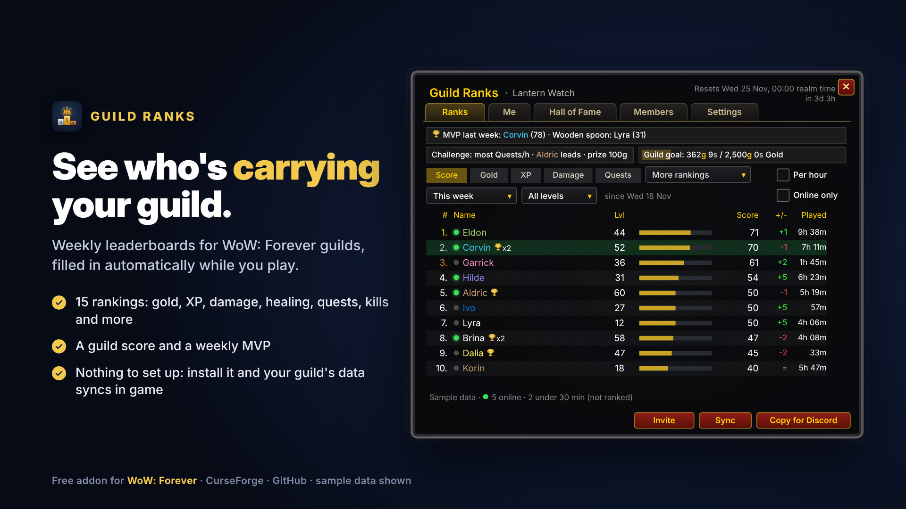
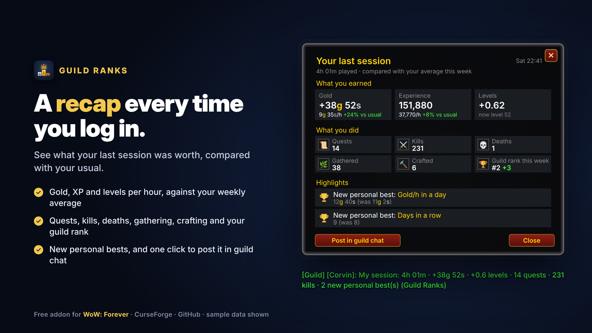

# Guild Ranks

**Weekly leaderboards for your guild.** See who's carrying the guild, chase your own records, and crown an MVP every week.

## Why your guild will love it

- 🏆 **A leaderboard for everything**: gold, XP, damage, healing, quests, kills, bosses, gathering, crafting, play time and more, plus a **Guild score** and a **weekly MVP**.
- ⚖️ **Fair for everyone**: ranked **per hour of play**, so a short evening can beat a long weekend. Level ranges let new players compete with each other.
- 📈 **Your own stats page**: your week compared with last week, personal goals, personal bests and a rival to race.
- 🔔 **Something to chase**: a card and a sound when you take #1, a heads-up when someone passes you, and weekly titles like *Gold Baron* and *Iron Man*.
- 🧾 **Session recap**: every login shows what your last session was worth, compared with your usual.
- ⚔️ **Guild vs Guild**: challenge other guilds to weekly matches in 8 categories. Live score, win/loss record and a card when the lead changes. Only guild averages are shared, never names.
- 🏁 **Race to 60 and 1v1 challenges**: see who hit max level first, and challenge a guildmate to a 1-hour gold, XP or kills race.
- 🛠️ **Guild tools**: who has which profession, when everyone was last online, and who's gone inactive (for officers).
- 💬 **Ready for Discord**: one click copies the week's results to paste in your server.
- 🔒 **Private and automatic**: no account, no website, nothing to set up.

## Get started

1. Install Guild Ranks (pick your **Forever** installation in the CurseForge app).
2. Type **/granks** in game, or click the minimap button.
3. Press **Invite** to tell your guildmates. Everyone who installs it shows up in the rankings.

Want a preview first? Type **/granks demo** to fill the window with sample data.

## Good to know

- **Everyone who wants to be ranked needs the addon.** Each player's addon records only their own character and shares it with the guild, inside the game.
- **Guild leaders set the rules** in Settings → Guild rules: reset day and hour, minimum play time, which gold sources count, a weekly challenge with a prize, a guild goal, and whether the guild appears in Guild vs Guild.
- **Privacy:** hide your play time or stop sharing at any time.
- **Damage and healing** need Blizzard's built-in damage meter (Options → Gameplay Enhancements).

## Commands

- **/granks**: leaderboard
- **/granks me**: your stats, goals, bests, rival and titles
- **/granks recap**: your session recap
- **/granks invite**: invite guildmates
- **/granks challenge**: challenge a guildmate to a 1v1 race
- **/granks race**: who reached level 60 first
- **/granks league**: Guild vs Guild
- **/granks discord**: copy results for Discord

Free and open source (MIT). Bugs and ideas: [GitHub Issues](https://github.com/SeanVella/GuildRanks/issues).
